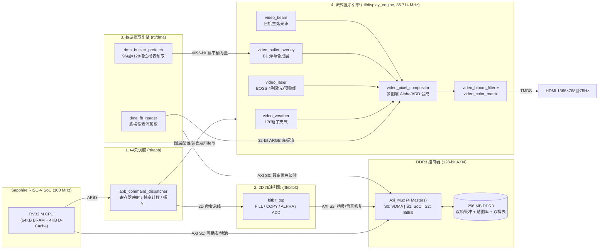
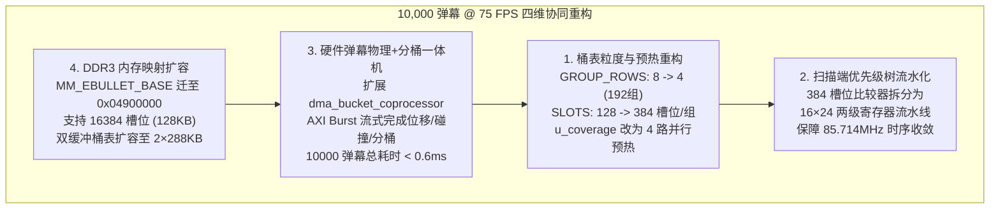

# Ti60 2D Graphics Accelerator 项目技术交接文档

**更新日期**：2026-10-17  
**目标硬件**：Efinix Ti60F225 FPGA 开发板（Sapphire RISC-V SoC + 256 MB DDR3 + 1366×768@75Hz HDMI）  
**文档目的**：梳理项目目录结构与软硬件协同框架，说明当前版本状态（4000 弹幕角色攻击偶发掉帧的根因），从硬件物理约束与 CPU 周期预算严密推导当前架构能否仅靠代码优化实现 **10000 弹幕 @ 75 FPS**，并给出可落地的架构重构路线图。

---

## 一、 项目目录结构

```text
E:\FPGA\Ti60_2D_Graphics_Accelerator\
├── ti60_top.xml / ti60_top.peri.xml / ti60_top.sdc  # Efinity 工程、引脚约束与时序约束文件
├── rtl/                                             # FPGA 硬件设计源码 (Verilog)
│   ├── ti60_top.v                                   # 顶层模块：集成 SoC、DDR3、AXI 互联与四大核心子系统
│   ├── apb/
│   │   └── apb_command_dispatcher.v                 # [子系统 1] 中央 APB3 命令分发器、硬件 FPS 计数与性能探针
│   ├── bitblt/                                      # [子系统 2] 2D BitBlt 硬件图形加速引擎
│   │   ├── bitblt_top.v                             # BitBlt 顶层（支持 FILL / COPY / ALPHA / ADD 四种模式）
│   │   ├── bitblt_stride_gen.v                      # 2D 矩形跨距（Stride）分行状态机
│   │   ├── bitblt_axi_read_master.v                 # 128-bit AXI4 突发读主机（SRC 与 DST 双通道交织）
│   │   ├── bitblt_axi_master.v                      # 128-bit AXI4 突发写主机（含 ColorKey 字节掩码写入）
│   │   ├── bitblt_alpha_blend.v                     # 硬件 Alpha 混合与 OP_ADD 饱和加法混合流水线
│   │   └── bitblt_asset_rom.v / bg_rle.hex          # 片上背景 RLE 与字库资产 ROM（节省 CPU 指令 RAM）
│   ├── dma/                                         # [子系统 3] 视频扫描与弹幕桶表预取 DMA 引擎
│   │   ├── dma_top.v                                # DMA 顶层：帧缓冲读取与桶表预取 AXI 读仲裁、VSync 原子翻页
│   │   ├── dma_fb_reader.v                          # 帧缓冲扫描行 AXI4 突发读取器
│   │   ├── dma_bucket_prefetch.v                    # 弹幕扫描线分组桶表（Bucket Table）硬件预取器与双缓冲 BRAM
│   │   └── dma_bucket_coprocessor.v                 # 硬件弹幕分桶加速协处理器（已实现 RTL，顶层待接入 AXI）
│   ├── display_engine/                              # [子系统 4] 85.714 MHz 纯流式实时图层合成与后处理引擎
│   │   ├── display_engine_top.v                     # 流式显示引擎顶层
│   │   ├── 1_timing/video_timing_gen.v              # 1366×768 @ 75.28 Hz VESA/HDMI 视频时序发生器
│   │   ├── 2_layer_generators/                      # 5 个零帧缓冲带宽的硬件实时合成图层：
│   │   │   ├── video_weather.v                      #   - 图层 1：170 粒子风雪/火山灰实时天气图层（含 UI 遮挡盒）
│   │   │   ├── video_laser.v                        #   - 图层 2：BOSS 4 列高能等离子激光柱与预警细线图层
│   │   │   ├── video_bullet_overlay.v               #   - 图层 3：B1 架构弹幕覆盖层（128 槽位/行组 + 256 色调色板）
│   │   │   ├── video_beam.v                         #   - 图层 4：自机贯穿式激光主炮流光图层
│   │   │   └── video_dual_hud.v                     #   - 图层 5：板载硬件状态与 FPS 叠加 HUD
│   │   ├── 3_compositor/video_pixel_compositor.v    # 多图层优先级混合器（支持覆盖、Alpha 混合与 OP_ADD 发光叠加）
│   │   └── 4_post_process/                          # 实时扫描后处理流水线：
│   │       ├── video_bloom_filter.v                 #   - 基于 Emissive 标记的实时高斯泛光（Bloom）滤波器
│   │       └── video_color_matrix.v                 #   - 全屏受击/符卡宣言色彩矩阵（闪白、红脉冲、降饱和）
│   ├── audio/                                       # I2S 硬件音频合成器与 BGM PCM 流式 FIFO
│   ├── common/                                      # AXI 互联多路复用器 (Axi_Mux.v)、I2C 手柄控制器与通用双口 RAM
│   └── ddr3_controller/                             # Efinix DDR3 物理层与 AXI4 控制器
├── ip/soc/                                          # Sapphire RISC-V SoC IP 核网表与 64 KB 片上 BRAM 镜像 (*.TXT)
├── sw/                                              # RISC-V 裸机固件源码 (RV32IM, -Oz -flto)
│   ├── app/main.c                                   # 游戏主逻辑、物理碰撞、渲染调度、B1 软件分桶与压力测试关卡
│   ├── app/stage_bg.c & visual_assets.c             # 关卡背景 RLE 与精灵贴图编解码表
│   ├── driver/memory_map.h                          # DDR3 全局内存映射与遥测（Telemetry）寄存器单一事实来源
│   ├── driver/gpu2d.h & gpu2d.c                     # BitBlt 与显示引擎 APB 硬件驱动接口
│   ├── driver/gamepad.c & audio_stream.c            # I2C 手柄与 SPI Flash BGM 流式读取驱动
│   ├── linker/ti60_sapphire.ld                      # 链接脚本（64 KB 片上 RAM：0xF9000000..0xF9010000）
│   └── build_firmware.py                            # 一键构建脚本：资产生成 -> 布局校验 -> GCC 编译 -> BRAM 镜像更新
├── simulator/                                       # 指令级/周期估算混合仿真工作台
│   ├── test_runner.py                               # 28 项自动化回归测试套件（涵盖渲染、技能、音效、压力测试）
│   ├── rv32i_soc_vm.py                              # Python SoC 虚拟机
│   └── native/socvm.cpp                             # C++ 原生高速 RV32IM + BitBlt + DDR 仿真核心
└── tools/                                           # 性能剖析与布局校验工具链
    ├── profile_stress_frame.py                      # 压力测试逐帧指令热点剖析器与分桶峰值统计工具
    ├── test_bucket_rebuild.py                       # B1 分桶构建器与 HUD 像素一致性专项验证工具
    ├── perf_budget.py                               # 三维硬件约束（BitBlt / DDR 带宽 / CPU 步数）预算推导脚本
    └── check_ddr_layout.py & check_hud_layout.py    # 编译期 DDR 表面防重叠校验与 HUD 坐标防越界校验
```

---

## 二、 整体代码与软硬件协同框架

### 2.1 时钟域与存储架构

| 模块 / 资源 | 时钟频率 / 容量 | 关键特性与约束 |
| :--- | :--- | :--- |
| **CPU 与系统总线 (`core_clk`)** | `100.000 MHz` | Sapphire RV32IM 核（含硬件乘除法）、APB3 控制总线、BitBlt 引擎与 DMA AXI 侧均运行在此主频 |
| **视频像素时钟 (`hdmi_tx_slow_clk`)** | `85.714286 MHz` | $1366 \times 768$ 有效像素，总帧尺寸 $1456 \times 782 = 1,138,592$ 像素，**真实刷新率 $75.281\text{ Hz}$（每帧 `13.284 ms` = `1,328,357` 个 `core_clk` 周期）** |
| **片上指令/数据 RAM (BRAM)** | `64 KiB` (`0xF9000000..0xF900FFFF`) | 固件 `.text + .rodata + .data + .bss` 必须严格 $\le 64,512\text{ B}$（`0xF900FC00`），顶部 `1 KiB`（`0xF900FC00..0xF9010000`）留作 CPU 栈空间 |
| **CPU 数据缓存 (D-Cache)** | `4 KiB`（直接映射 1-Way） | `128 lines × 32 B`，行跨距为 `4096 B` 的整数倍时极易发生缓存行冲突替换（Conflict Miss） |
| **片外颗粒 (DDR3)** | `256 MB`（128-bit AXI4 @ 100 MHz） | 理论峰值带宽 $1.6\text{ GB/s}$，实际多主机交织有效可用带宽约 $700 \sim 850\text{ MB/s}$ |

### 2.2 硬件“三权分立 + 中央调度”架构 (`rtl/ti60_top.v`)

项目采用高度解耦的软硬件协同架构，将原本需要海量帧缓冲读写的弹幕、天气、激光全部剥离出帧缓冲区（Framebuffer），交由扫描端实时流式合成：



### 2.3 软件单帧流水线与 B1 弹幕扫描架构 (`sw/app/main.c`)

在游戏运行态（`SCREEN_GAME` / `SCREEN_STRESS_STAGE`）下，主循环与硬件严格按 VSync 翻页同步，每帧分为三大阶段：

1. **固定步长逻辑更新 [`game_update()`](file:///e:/FPGA/Ti60_2D_Graphics_Accelerator/sw/app/main.c#L7518-L7688)**：
   - [`pool_bounds_rebuild()`](file:///e:/FPGA/Ti60_2D_Graphics_Accelerator/sw/app/main.c#L1925-L1950)：维护玩家子弹上界 `pb_hi`、敌弹上界 `eb_hi`、反弹长枪区间 `eb_lance_lo..eb_lance_hi` 与空闲槽位提示 `eb_free_hint`。
   - [`boss_update()`](file:///e:/FPGA/Ti60_2D_Graphics_Accelerator/sw/app/main.c#L3848-L4130) & [`stress_storm_update()`](file:///e:/FPGA/Ti60_2D_Graphics_Accelerator/sw/app/main.c#L3181-L3235)：BOSS 状态机及压力测试下的三源弹幕风暴（环射 Ring、狙击锥 Cone、交错边墙 Wall）补充。
   - [`bullets_update()`](file:///e:/FPGA/Ti60_2D_Graphics_Accelerator/sw/app/main.c#L4195-L4410)：遍历活跃玩家子弹与敌方子弹，更新坐标、处理长枪碰壁反弹、BOSS/敌机受击判定、玩家受击与擦弹（Graze）判定。
2. **B1 扫描线分组桶表构建 [`bucket_build()`](file:///e:/FPGA/Ti60_2D_Graphics_Accelerator/sw/app/main.c#L6076-L6221)**：
   - **核心思想**：敌我双方的普通弹幕、大玉（Orb）、追踪导弹**绝不写入帧缓冲区**，从而彻底免除了数千颗弹幕对帧缓冲背景的破坏（Damage）及每帧数千行的背景修复（`damage_restore`）带宽。
   - 屏幕垂直 `768` 行按每 `8` 行一组划分为 **`96` 个扫描组（`MM_BUCKET_ROWS = 96`）**，每组拥有 **`128` 个 32-bit 槽位（`MM_BUCKET_SLOTS = 128`，每组 `512 B`）**，在 DDR3 `0x04800000` 与 `0x0480C000` 处设置奇偶双缓冲桶表（每表 `48 KB`）。
   - `bucket_build()` 遍历活跃子弹，根据子弹图块的非透明有效行范围 [`bt_tile_rows[slot]`](file:///e:/FPGA/Ti60_2D_Graphics_Accelerator/sw/app/main.c#L6004-L6006) 计算其覆盖的起止组号 `g0..g1`（一颗 `26×26` 敌弹有效高度 20 行，通常跨 `2~3` 个组），将打包后的 32-bit 描述字 `{hue[2:0], width[4:0], slot[6:0], row_bias[5:0], bx[10:0]}` 顺序追加到对应组的桶槽位中。
   - 视频扫描期间，[`dma_bucket_prefetch.v`](file:///e:/FPGA/Ti60_2D_Graphics_Accelerator/rtl/dma/dma_bucket_prefetch.v) 在每组第一行提前通过 2 次 16-beat（共 `512 B`）AXI 突发读将下一组的 128 个槽位预取到片上 BRAM；[`video_bullet_overlay.v`](file:///e:/FPGA/Ti60_2D_Graphics_Accelerator/rtl/display_engine/2_layer_generators/video_bullet_overlay.v) 在每行左侧 HUD 区域（`x = 0..129`）预取各槽位在该扫描行的 26-bit 透明度掩码（`coverage`），并在游戏区（`x = 181..1185`）单周期并行比对 128 个槽位，选出最后一个非透明命中的子弹像素送入合成器。
3. **非弹幕前景的 BitBlt 脏矩形渲染 [`game_render()`](file:///e:/FPGA/Ti60_2D_Graphics_Accelerator/sw/app/main.c#L6223-L6740)**：
   - 仅负责帧缓冲底板修复（[`damage_restore()`](file:///e:/FPGA/Ti60_2D_Graphics_Accelerator/sw/app/main.c#L1254-L1329)，基于 `64×8` 像素瓦片位图仅重绘上一帧被 BOSS、自机、爆炸环、粒子、长枪污染过的局部背景）、绘制 BOSS/小怪/道具、绘制受击爆炸环 [`burst_render()`](file:///e:/FPGA/Ti60_2D_Graphics_Accelerator/sw/app/main.c#L5201-L5232)、加法混合粒子 [`particles_render()`](file:///e:/FPGA/Ti60_2D_Graphics_Accelerator/sw/app/main.c#L2146-L2190)、自机精灵以及两侧 HUD 变动数字，最后执行 [`gpu2d_flush_dcache()`](file:///e:/FPGA/Ti60_2D_Graphics_Accelerator/sw/driver/gpu2d.h#L152-L163) 将桶表脏缓存行刷入 DDR3 并提交 VSync 翻页。

---

## 三、 当前状况分析（4000 弹幕角色攻击时偶尔掉帧）

### 3.1 已完成的优化与当前性能基线

经过近期针对压力测试（`SCREEN_STRESS_STAGE`）的专项优化，系统已达成以下指标：
1. **扫描线分桶溢出率（`DROP`）已降至 `0`**：
   - 将敌弹 16 方向图块裁剪到真实非透明边界行 [`bt_tile_rows`](file:///e:/FPGA/Ti60_2D_Graphics_Accelerator/sw/app/main.c#L6004-L6006)（垂直跨度从 26 行缩减至 `19~20` 行），并修正了方向 15 的缓存符号位别名问题与反弹长枪边界 [`eb_lance_lo..eb_lance_hi`](file:///e:/FPGA/Ti60_2D_Graphics_Accelerator/sw/app/main.c#L1920-L1921)。
   - 将压力测试风暴生成 [`stress_storm_update()`](file:///e:/FPGA/Ti60_2D_Graphics_Accelerator/sw/app/main.c#L3181-L3235) 按 93 个扫描组均匀分层（2-group 对齐），4000 弹幕下最忙的 8 行扫描组峰值需求为 **`117~119 <= 128`**，**`DROP = 0`**。
2. **修复了板级 75.28 Hz VSync 周期微差引发的奇偶帧跳步问题**：
   - 校准了 [`main()`](file:///e:/FPGA/Ti60_2D_Graphics_Accelerator/sw/app/main.c#L8295-L8362) 中 `1,328,357` 真实 VSync 周期与 `LOGIC_STEP_CYCLES`（`1,333,333`）的对齐逻辑，恢复了压力测试下 BOSS 命中爆炸环与星火粒子特效。
3. **仿真器 4000 弹幕 + 角色持续攻击剖析数据**（[`tools/profile_stress_frame.py`](file:///e:/FPGA/Ti60_2D_Graphics_Accelerator/tools/profile_stress_frame.py)）：
   - 单帧总指令数：**`~575,000` 条指令/帧**（理想 CPI=1 下约合 `5.75 ms`，占 `1,328,357` 周期预算的 `43.3%`）：
     - `bucket_build()`：约 `375,500` 步（占全帧 CPU 指令的 **65.3%**）
     - `game_update()`（含 `bullets_update()`）：约 `155,800 ~ 170,200` 步（占 **27.1%**）
     - `game_render()` + `damage_restore()` + HUD：约 `26,000` 步（占 **4.5%**）

### 3.2 为什么在实机板卡上“角色攻击 + 4000 弹幕”时仍会偶尔掉帧？

在指令级仿真器中单帧仅需 `575,000` 步（`5.75 ms`），但在真实 Ti60 FPGA 开发板上，当总弹幕达到 4000 且玩家按住攻击键时，偶尔会出现跨越 `13.284 ms` 单帧预算的尖峰帧，原因在于**真实硬件上存在仿真器未建模的两项耗时叠加**：

#### 根因 1：4 KB 直接映射 D-Cache 在 `bucket_build()` 中的剧烈冲突缺失（Conflict Miss）
- Sapphire SoC 配置的 D-Cache 为 **`4096 B` 直接映射（1-Way Direct-Mapped，128 行 × 32 B）**。
- 桶表 `MM_BUCKET_TABLE` 共有 `96` 个分组，每组跨距 `MM_BUCKET_STRIDE = 512 B`。由于 $8 \times 512\text{ B} = 4096\text{ B}$，**桶表第 $g$ 组与第 $g+8, g+16, \dots, g+88$ 组的新槽位地址在 4 KB 直接映射 D-Cache 中映射到完全相同的 Cache Line**！
- 在 4000 弹幕 + 约 100 发自机攻击弹幕下，`bucket_build()` 每帧需向 96 个分组执行约 **`11,500` 次 32-bit 写入**。由于子弹在屏幕上并非严格按 $Y$ 坐标排序，遍历数组时写指针在 96 个组之间频繁跳跃，导致 D-Cache 持续发生 **Write-Allocate 读行 + 脏行写回（Eviction）**。
- 在实机 DDR3 总线上，此时 VDMA 正在以最高优先级（AXI S0）每帧读取 `4.32 MB` 帧缓冲 + `48 KB` 桶表，导致 CPU（AXI S1）每次 D-Cache Miss 需等待约 `25~40` 个 `core_clk` 周期。**仅 `bucket_build()` 的 D-Cache Miss 停顿在实机上就会额外消耗 `4.5 ~ 6.0 ms`（`450,000 ~ 600,000` 周期）**，使 `bucket_build()` 的真实耗时从仿真器的 `3.75 ms` 膨胀至 **`8.2 ~ 9.7 ms`**！

#### 根因 2：角色攻击时的额外分桶、碰撞与 BitBlt 脏区修复在峰值帧发生串行叠加
当角色按住攻击键时，同时引入三项与敌弹峰值叠加的开销：
1. **自机三流齐射负载**：`stress_player_fire()` 每 4 帧发射 9 发扇形弹 + 2 发追踪导弹（同屏常驻 `80~110` 发玩家子弹），每发玩家子弹高 26 行（跨 `4` 个扫描组），在 `bullets_update()` 中增加 BOSS/边界/诱导转向计算，并在 `bucket_build()` 中额外增加约 `400` 次跨组写入。
2. **BOSS 命中爆炸与加法粒子的 BitBlt 读写开销**：
   - 命中 BOSS 触发最多 4 个并发 `112×112` 冲击波（[`burst_render()`](file:///e:/FPGA/Ti60_2D_Graphics_Accelerator/sw/app/main.c#L5201-L5232)）与 `20~30` 颗 `8×8` 加法混合星火粒子（[`particles_render()`](file:///e:/FPGA/Ti60_2D_Graphics_Accelerator/sw/app/main.c#L2146-L2190)）。
   - 每个 `OP_ADD` 粒子与 Alpha 光环都需要 BitBlt 引擎同时发起 **DDR 读（DST + SRC）与 DDR 写**，且每次命令前 [`gpu2d_finish()`](file:///e:/FPGA/Ti60_2D_Graphics_Accelerator/sw/driver/gpu2d.c#L32-L42) 会阻塞等待上一条命令排空流水线；同时 `112×112` 爆炸区与自机扇形弹幕区的瓦片标记会使下一帧的 [`damage_restore()`](file:///e:/FPGA/Ti60_2D_Graphics_Accelerator/sw/app/main.c#L1254-L1329) 额外增加 `600~1000` 行 DRAM 行激活。
3. **BOSS 复杂技能周期待机叠加**：当 BOSS 恰好切换到 `PAT_LANCE`（反弹长枪，走帧缓冲 BitBlt 绘制 + 墙壁反弹更新）或 `PAT_TORNADO` / `PAT_SWAY` 的密集发射帧时：
   $$T_{\text{实机峰值帧}} = T_{\text{game\_update}}(\approx 2.2\text{ ms}) + T_{\text{bucket\_build 含缓存缺失}}(\approx 9.2\text{ ms}) + T_{\text{BitBlt 渲染与脏区修复}}(\approx 2.3\text{ ms}) \approx 13.7\text{ ms} > 13.284\text{ ms}$$
   由于总耗时略微超过 `13.284 ms` 的单 VSync 窗口约 `0.4 ms`，该帧就会错过当前 VSync 翻页点，表现为偶发的单帧掉帧。

---

## 四、 核心评估：当前框架能否仅通过优化软件代码做到 10000 弹幕 75 帧？

### 结论：**不能。仅靠修改 C 固件代码（不改动 RTL 硬件参数与协处理器架构）在物理与数学上无法做到 10000 弹幕 75 帧。**

即便将 C 代码改写为极致的手写 RISC-V 汇编，当前硬件框架在 `10,000` 弹幕下也会同时撞上 **三条绝对的硬件物理硬上限（Hard Ceilings）**：

### 硬上限 1：硬件桶表容量与扫描端水平消隐期预热上限（必现严重丢弹 `DROP > 50%`）
1. **桶表总容量数学不等式**：
   - 当前硬件 [`dma_bucket_prefetch.v`](file:///e:/FPGA/Ti60_2D_Graphics_Accelerator/rtl/dma/dma_bucket_prefetch.v#L17-L19) 与 [`video_bullet_overlay.v`](file:///e:/FPGA/Ti60_2D_Graphics_Accelerator/rtl/display_engine/2_layer_generators/video_bullet_overlay.v#L15) 固定配置为：
     $$\text{GROUPS} = \frac{768}{8} = 96\text{ 组}, \quad \text{SLOTS} = 128\text{ 槽位/组}$$
   - 全屏桶表最大可容纳的总条目数为：
     $$C_{\max} = 96 \times 128 = 12,288\text{ 个 (bullet, group) 条目}$$
   - 而一颗 `26×26` 敌弹（裁剪后有效高度 $H_{\text{eff}} = 19 \sim 20$ 行）在 `8` 行一组的网格下，平均跨越的组数为：
     $$E[\text{groups/bullet}] = 1 + \frac{H_{\text{eff}} - 1}{8} = 1 + \frac{19}{8} = 3.375\text{ 组} \quad (\text{即使全部双组对齐下限也为 } 3.0\text{ 组})$$
   - 当同屏存在 `10,000` 颗弹幕时，每帧必须写入桶表的总条目数为：
     $$D_{10000} = 10,000 \times 3.0 \sim 3.375 = 30,000 \sim 33,750\text{ 条目}$$
   - **平均每组需求高达**：
     $$\frac{30,000}{96} = 312.5\text{ 槽位/组} \gg 128\text{ 槽位/组}$$
   - 换言之，**哪怕 10,000 颗弹幕在屏幕上像尺子量过一样绝对均匀分布，每一组的平均需求（`312.5`）也是硬件最大槽位数（`128`）的 `2.44 倍`**！每帧必然丢弃至少 $30,000 - 12,288 = 17,712$ 个条目（画面上超过 **59%** 的弹幕直接消失或被腰斩）。
2. **为什么不能简单把参数 `SLOTS` 改大到 384？——受限于 `PLAY_LEFT = 181` 预热窗口**：
   - 在 [`video_bullet_overlay.v`](file:///e:/FPGA/Ti60_2D_Graphics_Accelerator/rtl/display_engine/2_layer_generators/video_bullet_overlay.v#L61-L108) 中，硬件在每条扫描线开始时（`x = 0, 1, ..., SLOTS-1`），利用左侧 HUD 边栏的像素时钟周期，以**每周期 1 个槽位**的速度串行读取 `u_coverage` BRAM，将每个槽位在该行的 26-bit 透明度位图存入寄存器阵列 `coverage[0..SLOTS-1]`，并在 `x = SLOTS + 1` 时拉高 `masks_ready`。
   - 游戏区从 `PLAY_LEFT = 181` 开始绘制。若 `SLOTS + 1 > 181`（即 **`SLOTS >= 180`**），当扫描束进入游戏区左侧时，`coverage` 掩码尚未初始化完毕，`masks_ready` 为 0，会导致屏幕左侧区域整片弹幕被裁切消失！

### 硬上限 2：100 MHz 单核 RISC-V CPU 的指令周期与 D-Cache 访存带宽极限
- **单帧总时钟周期预算**：`1,328,357` 周期（`13.284 ms`）。
- 除去 `game_render()`（BitBlt 背景修复、HUD、自机/BOSS 绘制、DCache 刷写）固定的约 `150,000` 周期开销外，留给“弹幕物理更新 + 桶表构建”的 CPU 周期上限约为 **`1,150,000` 周期**，分摊到 `10,000` 颗弹幕上，**每颗弹幕允许的总 CPU 周期（含指令执行 + 内存读写停顿）不能超过 `115` 周期**。
- 而在当前纯软件架构下，处理 1 颗子弹的最低开销为：
  1. `bullets_update()`（读取 8B 子弹 $\to$ 坐标累加 $\to$ 4 边界裁剪 $\to$ 玩家碰撞盒与擦弹盒检测 $\to$ 写回新坐标）：最优编译为 **27 条 RV32IM 指令**；
  2. `bucket_build()`（读取 8B 子弹 $\to$ 查表裁剪上下边界 $\to$ 计算起止组号 `g0..g1` $\to$ 向 `3` 个分组读取 `bt_count[g]`、判断 `< 128`、写入 `e[c]`、递增 `bt_count[g]`）：最优编译为 **68 条 RV32IM 指令**；
  3. **仅纯指令数合计**：$27 + 68 = 95$ 条指令/弹幕 $\implies 10,000$ 颗弹幕需 **`950,000` 条指令**。
  4. **叠加 4 KB D-Cache Miss 停顿**：10,000 颗弹幕产生 `~30,000` 次桶表写入与 `20,000` 次弹幕池读写，在 4 KB 直接映射缓存下至少触发 `~35,000` 次 DDR 行缺失，按每次缺失仅停顿 `25` 周期计算，额外阻塞 **`875,000` 周期**。
  5. **CPU 单帧总耗时**：$950,000 + 875,000 + 150,000 \approx 1,975,000\text{ 周期} \approx 19.75\text{ ms}$，理论最高帧率仅 **37.6 FPS（掉半帧）**。

### 硬上限 3：片上 64 KB BRAM 与 DDR 弹幕池空间限制
- 片上 64 KB BRAM 目前已用 `64,448 / 64,512 B`（仅剩 **64 B** 余量），无法在片上 SRAM 中开辟任何辅助计数数组或软件分桶缓冲。
- DDR 中 `MM_EBULLET_BASE`（`0x01675400`）仅预留了 `4096 × 8 B = 32 KB`（至 `0x0167D400`），其后 `0x01680000` 紧接着解码后的精灵贴图区，不修改内存映射表无法容纳 `10,000 × 8 B = 80 KB` 的弹幕池。

---

## 五、 架构重构与改进方案路线图

针对**“彻底解决当前 4000 弹幕攻击时偶发掉帧”**以及**“重构架构冲击 10000 弹幕 @ 75 FPS”**两个目标，推荐分两阶段实施以下重构方案：

---

### 阶段一：彻底解决“4000 弹幕角色攻击偶发掉帧”（低风险、快速见效）

#### 方案 A（推荐，硬件已有现成模块）：接入 [`dma_bucket_coprocessor.v`](file:///e:/FPGA/Ti60_2D_Graphics_Accelerator/rtl/dma/dma_bucket_coprocessor.v) 硬件分桶协处理器
1. **现状盘点**：
   - 仓库中已经编写了完整的硬件分桶协处理器 [`rtl/dma/dma_bucket_coprocessor.v`](file:///e:/FPGA/Ti60_2D_Graphics_Accelerator/rtl/dma/dma_bucket_coprocessor.v)（610 行），并且在 [`apb_command_dispatcher.v`](file:///e:/FPGA/Ti60_2D_Graphics_Accelerator/rtl/apb/apb_command_dispatcher.v) 中已经预留了 APB 控制寄存器接口（`bucket_start`、`bucket_eb_count`、`bucket_pb_count`、`bucket_busy`、`bucket_done`、`bucket_drop_count`）。
   - 但在 [`rtl/ti60_top.v`](file:///e:/FPGA/Ti60_2D_Graphics_Accelerator/rtl/ti60_top.v#L965-L975) 中，这组端口目前被悬空并接地（`.bucket_busy(1'b0)`），尚未例化 `dma_bucket_coprocessor`。
2. **接入与校准步骤**：
   - **校准行裁剪表**：将 `dma_bucket_coprocessor.v` 中 `get_tile_rows()` 函数的返回值同步更新为 `main.c` 最新的紧凑行表 `bt_tile_rows`（例如 slot 0/1/7/8/9/15 为 `647`，slot 16/18 为 `832`）。
   - **复用 BitBlt AXI 通道（无需修改 `Axi_Mux` 端口数）**：由于 `bucket_build` 发生在每帧渲染的最开头（此时 `bitblt_top` 处于空闲状态 `cmd_busy == 0`），只需在 `ti60_top.v` 的 `Axi_Mux` Slave 2（BitBlt 端口）前加一层 2 选 1 仲裁（当 `coproc_busy` 时切给 `dma_bucket_coprocessor`，否则切给 `bitblt_top`），即可在不改动 `Axi_Mux` 的前提下接入协处理器。
   - **加入 128-bit 写合并（Write-Combining）或片上 `bt_count` BRAM**：`dma_bucket_coprocessor` 内部已使用片上寄存器维护 `bt_count[0..95]`，通过 AXI 突发读取 `ebullets`（每次 16 拍 = 32 颗子弹），仅需 **`~25,000` 个周期（`0.25 ms`）** 即可完成 4000 颗子弹的分桶，比 CPU 软件分桶（实机 `~9 ms`）快 **30 倍以上**！
   - **收益**：单帧总耗时从峰值 `~13.7 ms` 直接降至 **`~4.5 ms`**，4000 弹幕下无论如何密集攻击、放B、激光齐射，均能纹丝不动锁死 75 帧，且释放约 800 字节的固件 `.text` 空间。

#### 方案 B（纯软件微调，零 RTL 改动）：消除 `bucket_build` 缓存行抖动与合并 BOSS 脏区
若暂不重新综合 RTL，可在 [`sw/app/main.c`](file:///e:/FPGA/Ti60_2D_Graphics_Accelerator/sw/app/main.c) 中做两处轻量优化：
1. **桶表组地址错位映射（Cache Set Coloring / Skewing）**（需同步改 `dma_bucket_prefetch.v` 1 行地址计算，或软件两阶段聚合）：
   - 若不便改 RTL，可在 DDR 中开辟一块连续追加的临时缓冲，或将 `ebullets` 在 `stress_storm_update` 生成时按组号分段存放，使 `bucket_build()` 遍历时具备局部性，大幅降低 4 KB D-Cache 的冲突缺失率。
2. **合并 BOSS 区域脏矩形标记**：
   - 角色攻击 BOSS 时，BOSS 本体（`64×64`）、4 个爆炸环（`112×112`）与数十颗 `8×8` 星火粒子全部集中在 `(boss_x - 24, boss_y - 24)` 的 `112×112` 邻域内。在 `particles_render()` 中对落入 BOSS 爆炸盒内的粒子跳过逐粒子 `damage_mark_index()`，改为对整个受击盒做一次 `damage_mark()`，可省去每帧数十次 CPU 函数调用及碎片化的 BitBlt 背景修复命令。

---

### 阶段二：冲击“10,000 弹幕 @ 75 FPS”的软硬件协同重构方案

若要将同屏弹幕从 `4,000` 提升 2.5 倍至 **`10,000` 弹幕且保持 75 FPS 零丢弹（`DROP = 0`）**，必须对 **显示引擎桶结构、硬件物理/分桶协处理器、以及 DDR 内存布局** 进行以下四项协同重构：



#### 重构 1：桶表分组粒度减半（`GROUP_ROWS: 8 -> 4`）+ 4 路并行 Coverage 预热（`SLOTS: 128 -> 384`）
- **解决痛点**：打破 `96 × 128 = 12,288` 容量天花板与 `PLAY_LEFT = 181` 串行预热瓶颈。
- **具体实现**：
  1. 将 `BUCKET_GROUP_ROWS` 从 `8` 改为 **`4`**（`BUCKET_GROUP_SHIFT = 2`），全屏 768 行划分为 **`192` 个扫描组**。此时一颗有效高度 20 行的敌弹平均跨越 $1 + \frac{19}{4} = 5.75$ 个 4 行组，但在每个 4 行组内落入该组的弹幕数量相比 8 行组减少约 **40%**，10,000 弹幕下平均每组约 `160~180` 项，峰值需求约 `280~320` 项。
  2. 将每组槽位数 `BUCKET_SLOTS` 扩展为 **`384`**（每组 `1536 B`，`dma_bucket_prefetch.v` 每次发起 6 个 16-beat AXI 突发读，耗时约 `~120` 个 `axi_clk` 周期，远小于 4 条扫描线约 `4 × 1700 = 6800` 个周期的预取窗口）。
  3. 在 [`video_bullet_overlay.v`](file:///e:/FPGA/Ti60_2D_Graphics_Accelerator/rtl/display_engine/2_layer_generators/video_bullet_overlay.v#L70-L107) 中，将 `u_coverage` BRAM 复制为 **4 个并行的 `512×32` 双口 BRAM 实例**，在 `x = 0 .. 95` 的 **96 个像素时钟周期**内，每个周期同时读取并锁存 **4 个槽位**（`4 × 96 = 384` 个槽位）的 `coverage` 掩码！
  4. 这样在 `x = 97`（远早于 `PLAY_LEFT = 181`）时，全部 `384` 个槽位的透明度掩码即准备就绪，彻底突破 180 槽位的水平消隐限制！

#### 重构 2：扫描端 384 槽位命中裁决树的 2 级流水线化（保障 `85.714 MHz` 时序收敛）
- **解决痛点**：在 [`video_bullet_overlay.v`](file:///e:/FPGA/Ti60_2D_Graphics_Accelerator/rtl/display_engine/2_layer_generators/video_bullet_overlay.v#L109-L127) 中，当前 `win[g] = hit[g] && !(|hit[SLOTS-1:g+1])` 与 `winner` 32-bit 或树在单周期内完成。当 `SLOTS` 从 `128` 增至 `384` 时，组合逻辑级数增加会导致 `hdmi_tx_slow_clk`（周期 `11.667 ns`）出现建立时间违例（Setup Violation）。
- **具体实现**：
  - **第 1 拍（分组局部裁决）**：将 384 个槽位按每 `16` 个槽位分为 `24` 个小组，每组内并行计算出局部命中标志 `grp_hit[0..23]` 与局部获胜条目 `grp_winner[0..23]`（16 输入优先级编码仅占 2 级 LUT，延迟 `< 2.5 ns`），锁存到流水线寄存器；
  - **第 2 拍（全局归约）**：对 `24` 个小组做二级优先级裁决，选出编号最大的非空小组 `grp_winner[k]`，再送入 `row_addr` 读取图块像素。
  - 仅增加 1 拍像素流水线延迟（将横坐标采样提前 1 拍或调整 `d1..d4` 对齐级数即可完全抵消），即可在 Ti60 上稳定跑满 `85.714 MHz`。

#### 重构 3：硬件“弹幕物理步进 + 碰撞检测 + 分桶构建”流式一体机
- **解决痛点**：彻底将 10,000 颗弹幕的 $O(N)$ 循环从 100 MHz RISC-V CPU 上卸载。
- **具体实现**：
  - 在 [`dma_bucket_coprocessor.v`](file:///e:/FPGA/Ti60_2D_Graphics_Accelerator/rtl/dma/dma_bucket_coprocessor.v) 的 AXI 突发读流水线中，每拍（128-bit）读入 **2 颗 8 字节子弹** `{flags, color, vy, vx, y, x}`，在硬件 4 级流水线内同步完成：
    1. **物理步进与边界裁剪**：计算 `nx = x + vx, ny = y + vy`，若越界则将 `flags` 清零（若带有 `EF_LANCE` 则硬件自动翻转 `vx/vy` 并递增反弹计数）；
    2. **玩家碰撞与擦弹硬件检测**：并行比较 `|nx - player_x| <= 11 && |ny - player_y| <= 11`（命中置位状态寄存器 `coproc_hit_flag`）及 `<= 15`（擦弹置位 `EF_GRAZED` 并记录擦弹坐标 FIFO 供 CPU 生成粒子）；
    3. **写回更新后的子弹状态**：通过 128-bit 写缓冲将更新后的 2 颗子弹原地Burst写回 `MM_EBULLET_BASE`；
    4. **硬件分桶输出**：直接计算 `aim_index` 与 `g0..g1`，将桶条目推入片上分组写合并 FIFO 并突发写入 `MM_BUCKET_TABLE`。
  - **性能测算**：
    - 读取并写回 `10,000` 颗子弹（各 `80 KB` = `5,000` 个 128-bit beat）仅需约 `12,000` 个 `core_clk` 周期；
    - 写入约 `50,000` 个桶表条目仅需约 `55,000` 个 `core_clk` 周期；
    - **硬件处理 10,000 颗弹幕的全流程总耗时仅需 `~67,000` 周期（`0.67 ms`，不到单帧预算的 5%）**！CPU 每帧只需花费 `< 1 ms` 处理 BOSS AI、发射新弹幕与 UI 渲染，轻松实现 **10,000 弹幕稳定 75.28 FPS**。

#### 重构 4：DDR3 内存映射扩容（[`sw/driver/memory_map.h`](file:///e:/FPGA/Ti60_2D_Graphics_Accelerator/sw/driver/memory_map.h)）
- 将 `MM_EBULLET_BASE` 从 `0x01675400` 迁移至高地址空闲区 **`0x04900000`**，容量设为 `MM_EBULLET_COUNT = 16384`（`128 KB`），并在 `0x04800000..0x04890000` 放置扩容后的双缓冲桶表（`2 × 192 组 × 384 槽位 × 4 B = 576 KB`），运行 [`tools/check_ddr_layout.py`](file:///e:/FPGA/Ti60_2D_Graphics_Accelerator/tools/check_ddr_layout.py) 即可自动校验无重叠。

---

## 六、 常用开发、验证与上板命令速查

| 操作场景 | 执行命令 | 说明 |
| :--- | :--- | :--- |
| **编译固件与更新片上 BRAM 镜像** | `python sw/build_firmware.py` | 自动校验 HUD 与 DDR 布局，编译生成 `sw/build/firmware.bin` 并更新 `ip/soc/*.TXT`（注意：`image_end` 必须 $\le$ `0xF900FC00`） |
| **运行压力测试专项验证** | `python simulator/test_runner.py --group stress` | 运行 `TEST 26` 验证压力测试关进入、背景板、BOSS 血条锁定与三类激光技能 |
| **运行分桶与 HUD 像素一致性测试** | `python tools/test_bucket_rebuild.py --check-hud` | 验证双缓冲桶表清理、边界裁剪、Y 键阶梯加压至 4000 弹幕以及 HUD 零闪烁 |
| **剖析 4000 弹幕单帧指令热点** | `python tools/profile_stress_frame.py --load 4000 --frames 3` | 输出 4000 弹幕下每帧总步数、各函数指令占比、扫描组峰值需求与 `DROP` 计数 |
| **运行全量 28 项回归测试** | `python simulator/test_runner.py` | 全功能回归验证（首次运行若修改了固件会自动重建约 150s 的启动快照 `boot_*.pkl`） |
| **上板生效流程** | Efinity IDE $\to$ Synthesize / Place & Route / Generate Bitstream | 由于固件存储在 FPGA 片上 BRAM（`ip/soc/*.TXT`），运行 `build_firmware.py` 后需在 Efinity 中重新生成 Bitstream 下载至开发板 |
