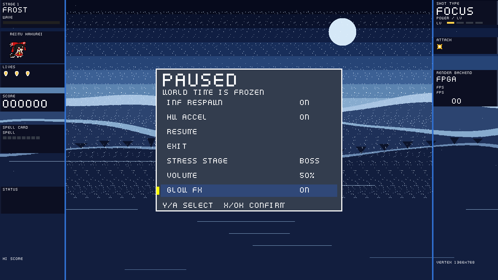

# Ti60 恢复记录（2026-10-24）

这是首轮恢复的记录。板上发现的 1088 负载卡顿及 DROP=65535 修正见
[DROP65535_FIX.md](DROP65535_FIX.md)，当前构建资源/时序以该修正记录为准。

## 来源与范围

原始备份：`D:\Ti60_2D_Graphics_Accelerator (3)(1)\Ti60_2D_Graphics_Accelerator`。
恢复工作目录：`D:\Ti60_Recovery_20261024\Ti60_2D_Graphics_Accelerator`。
原始备份未修改，故障外置盘未写入。

除旧备份外，已从本机保留的 7 份 Codex 会话中提取补丁、源码读取结果和编译记录。
证据副本、索引、重建脚本位于 `C:\Users\TimeCheney123\Ti60_recovery_20261024`。
没有完整、连续的最终源码快照，因此本工程是恢复实现，不能称为丢失版本的逐字节副本。
早先自动回放的补丁存在缺口；当前实现经过人工整合、编译及功能验证。

## 当前架构

- Ti60F225 I3；Sapphire RV32IM/ILP32，100 MHz；固件 GCC -Oz/LTO。
- APB 命令分发、DDR DMA、显示流水线分离；BitBlt 支持 FILL/COPY/ALPHA/ADD。
- DDR AXI 四路仲裁：视频、CPU、BitBlt、弹幕协处理器。
- 1366×768；总时序 1456×782，像素时钟约 85.714 MHz，标称刷新约 75.28 Hz。
- 双帧缓冲 0x00800000 / 0x00E00000，行距 8192；0x134 一次发布左右地址。
  基准模式左右分界为 512 像素。
- 敌弹池 8192，末 32 项为 orb；玩家弹池 512。CPU 处理 lance/orb 尾部与游戏交互，
  硬件负责普通敌弹移动、边界剔除、候选收集及分桶。
- 每桶覆盖 8 行；双桶表，每组 1024 项；扫描线预绘制使用双行缓冲和 32 个存储 bank。
- 索引贴图支持 27 种图块（包括 8 个 lance 方向），调色板 alpha=254 表示加法效果。

`dma_fb_reader.v` 来自 10 月 23 日会话的完整源码输出。
`dma_bucket_coprocessor.v` 的接口与几何规则有历史依据，但部分状态机依据接口契约重新实现。
该实现不依赖硬件 free-list；分配仍采用固件的查找逻辑。

## 恢复与修复

1. 接回四路 AXI 和实际 BitBlt 读写通路，清理旧别名留下的悬空驱动。
2. 双帧原子发布、帧切换时排空已接受的读事务、延迟数据丢弃和像素相位恢复，
   用于处理菜单打开时顶部黑闪/错位的相关路径。实际显示器现象尚待开发板确认。
3. 暂停卡片新增 `GLOW FX` 开关；保持原有其他菜单项。
   仅找到 `bloom_style_sel`（柔光核宽度选择），没有确认独立的两种子弹样式开关，
   因而没有凭空增加该选项。
4. 恢复彩色圆形 halo、Alpha 和 ADD，命中十字特效前 16 帧保持不透明，随后 8 帧短衰减。
   此次未声称复刻某个东方原作的素材或全部视觉细节。
5. 柔光中心两行存 RGB888 + 发光标记；远端两行仅光晕使用 RGB555。
   背景/旁路仍保留 RGB888；远端光晕每通道量化误差最多 7。
   16×128 位弹幕 burst 临时数据改用寄存器，降低 BRAM 占用。
6. BitBlt 超时后完成已接受的 AXI 写突发；剩余 beat 使用零字节使能。
   遇到反压保持 VALID、数据、掩码与 LAST 稳定，读通路排空响应后才接受下一命令。
   对永不返回响应的外部总线不虚构“自动恢复”。
7. 候选列表只保存前 512 个，但计数保留真实总数，溢出时 CPU 全扫描补查碰撞；
   修正命中后活动数更新、HUD 16 位数量、lance 紧凑索引。
8. 运行时小表迁入经过布局检查的 DDR 工作区；保留 768 字节栈和严格镜像尺寸门限。
   固件镜像 64252 字节，含 BSS 的结束地址 0xF900FCF0，距栈下界仅 16 字节。
   后续增加固件逻辑应继续做尺寸检查，不能降低栈保护来绕过失败。
9. 补回背景/字体 ROM 地址寄存器的复位和写入。
10. 修复仿真内存布局、扩展 APB、分桶模型及 32 KiB 贴图存储。
    默认使用 Python 内核；旧 native 扩展未验收，只有显式 `SIM_USE_NATIVE=1` 才启用。
    复核截图时发现仿真器仍读取旧 `bg_rle.hex`，已改为含字体的 `asset_rom.hex`。
    启动缓存键同时包含固件与 ROM 内容哈希，避免沿用空字体缓存。

## 验证

命令均在恢复工作目录执行。日志在 `work_sim`；以下数字为实际执行结果，
软件 VM 的指令步数和帧数不等同于板上 FPS。

| 验证 | 结果与证据 |
|---|---|
| 严格固件构建 | `python sw/build_firmware.py`，-Wall/-Wextra/-Werror、链接尺寸和 BRAM 初始化回读通过 |
| DDR 地址布局 | `python tools/check_ddr_layout.py`：55 个区域、26 个素材无重叠 |
| 分桶硬件 | `tools/sim_bucket_accel.ps1 -Large`：8192 池、16-beat 读取，经真实四路仲裁器与高优先级读并发；反压、双表、奇数长度、读错误、移动/剔除、600 个候选通过 |
| 扫描线与预取 | `tools/sim_scanline.ps1`：真实固件贴图；49504 像素、1024 项覆盖、27 种图块、遮挡；4096 项/64 突发及帧中止/CDC 通过 |
| 帧稳定性 | `tools/sim_frame_stability.ps1`：双地址原子发布、AR 停顿/排空、71115 像素/66 行零相位错位 |
| BitBlt | `tests/run_bitblt_portable.ps1`：153 个 FILL/COPY 向量、86 个 Alpha 向量、64-beat 突发及配置保护通过；`-Large` 的 124/125/600 行 COPY 和暂停卡片 COPY/ALPHA+Key 通过 |
| Alpha/ADD | `tb_alpha_fade.sv`：两种模式各 8192 像素；透明键、目的 alpha、全局 alpha、饱和及反压通过 |
| 写超时 | `tb_recovery_write_abort.sv`：AW/W 停顿时取消、完整突发、下一突发恢复通过 |
| 柔光 | `tb_bloom_filter.sv`：紧核 7 像素、宽核 13 像素，RGB 同形、发光隔离、旁路通过 |
| 音频 | `tools/sim_bgm_stage_b.ps1`：FIFO、APB 隔离、全部 760 字体字节、6 项 C 上传协议、12 kHz PCM、混音与 I2S 通过 |
| 游戏逻辑 | `tools/test_attack_effects.py`：24 帧特效、移动恰好一次、空作业和候选溢出碰撞、450 帧普通战役通过 |
| 字体像素 | `tools/test_recovery_menu.py`：6 种字体缩放的 26208 个像素逐点对照 ROM |
| 高负载功能 | `tools/test_boss_sustained.py --frames 120 --load 8000 --report work_sim/boss8000_final.json`：120 帧、2 种模式，最小活动数量 7498，最大桶丢弃 0；未覆盖全部 17 种模式 |

最终硬件构建：`hardware_recovery_final2.log` 的 map/interface/pnr/pgm 全部通过。
这里的 pgm 是生成配置文件，没有连接或烧录开发板。

| 最终实现资源/时序 | 数值 |
|---|---|
| XLR | 50658 / 60800 |
| BRAM | 254 / 256 |
| DSP | 66 / 160 |
| core_clk setup / hold slack | +0.688 ns / +0.026 ns |
| hdmi_tx_slow_clk setup / hold slack | +1.758 ns / +0.027 ns |
| bit / hex 大小 | 3127209 / 3127269 字节 |

资源来自 `outflow/ti60_top.place.rpt`，时序来自最终 `outflow/ti60_top.timing.rpt`。
当前资源余量很小，后续改动需重新综合，不应沿用历史版本的资源数字。
菜单完整控制流程通过：暂停、HW ACCEL 开关、无限复活、GLOW FX 开关、恢复及退出，
见 `work_sim/settings_final.log`。
ROM 修正后另用 `tools/test_recovery_menu.py` 验证真实字体像素、标签、GLOW FX OFF/ON、
暂停时世界冻结和 RESUME，均通过；最小 SP 为 0xF900FE50。
最终 Alpha 游戏测试也在修正 ROM 后重新通过，见 `work_sim/alpha_game_final.log`。

## 已知差异与开发板验收

- 丢失版本的部分记录提到每桶 1280 项；当前是经过一致性验证的 1024 项/4096 字节行距。
  本次未将容量改为 1280，也未声称该性能优化已经恢复。
- 自动从 Flash 加载 BGM 尚未恢复。背景/字体保留在 BRAM，音效和 PCM/I2S 数据通路已恢复；
  BGM 需运行 `python tools/upload_bgm.py --help` 按串口参数上传。
  旧顶层 SPI0 没有接到配置 Flash，不能只增加固件调用就声称可上电播放。
- APB 0x130 心跳写接口存在，但独立硬件 UART 接管诊断尚未接回。
- 历史文档、旧 native 仿真扩展和未运行的遗留脚本不能作为当前版本的验收证据。
- 尚未烧录。需板上验证上电启动、HDMI 连续输出、菜单反复开关无顶部黑闪、GLOW FX 的视觉变化、
  8000 目标负载连续运行、真实 FPS、按键和串口 BGM。

## 备份

首轮归档保存在 `D:\Ti60_Recovery_20261024\release_20261024`。
当前运行 `python tools/package_recovery.py` 会创建 `D:\Ti60_Recovery_20261024\release_drop65535_fix_20261024`，
包含源码压缩包、原始/恢复源码 SHA-256 清单、关键构建产物校验和。
压缩包排除工具运行库、Git 历史和仿真/综合临时文件；完整工作目录仍保留这些文件。
证据 JSONL 副本未放入源码包，应单独妥善保存。
通过的验证日志、负载报告和菜单截图保存在 `docs/recovery_evidence`，会包含在源码包中。
源码包、清单和校验和也复制到 `C:\Users\TimeCheney123\Ti60_recovery_20261024` 下对应的 release 子目录。
这只是本机的第二份副本，不代表已经获得异地备份。
