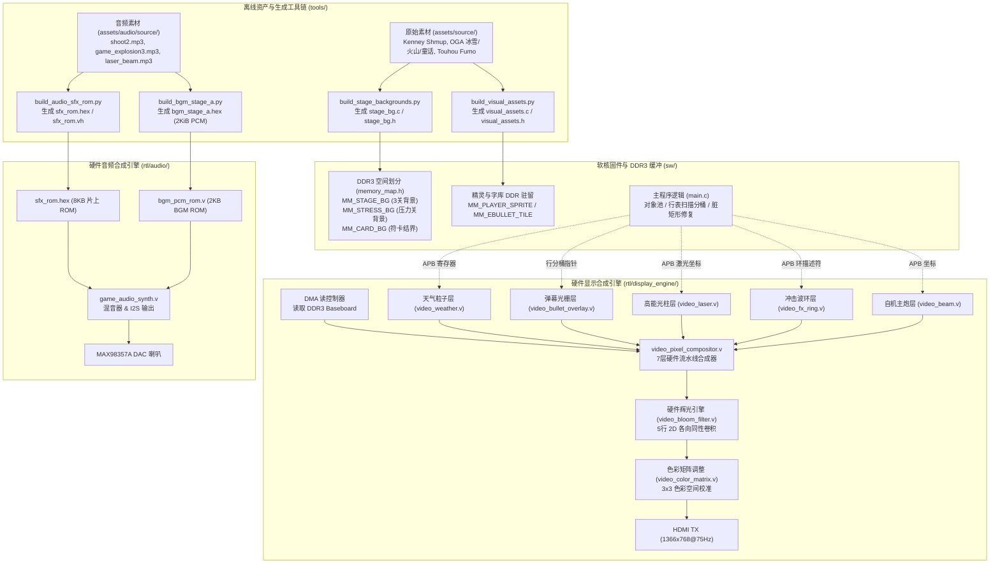
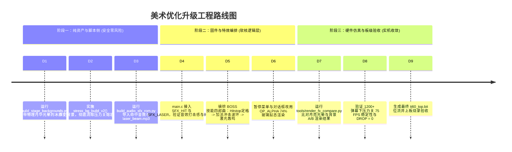

# Ti60 2D 图形加速器全方位美术与视听特效优化指导方案

> **文件版本**：v1.0  
> **编写日期**：2026-10-25  
> **面向架构**：Efinity Ti60F225 FPGA 硬件加速渲染平台 + RISC-V 32位软核固件  
> **显示规范**：1366×768 @ 75.3 Hz（点频 85.712 MHz，总线架构 AXI3/AXI4 + APB 控制）

---

## 一、 整体文件结构与视效链路审查总览

在对当前工程的硬件 RTL、固件源码、驱动层、离线资产编译脚本及仿真回放体系进行全方位代码审计后，提炼出当前系统的全链路图形/音频资产分布架构：



### 1.1 核心资产现状审查表

| 资产/模块 | 当前实现方式 | 物理载体 | 存在的核心视觉/声效缺陷与瓶颈 |
|---|---|---|---|
| **压力测试背景** | `stress_bg_build()` 在 C 语言运行时逐像素生成 | DDR3 `MM_STRESS_BG` (4.2 MB) | 画面呈生硬锯齿暗褐山脉与亮黄高光熔岩口，底部高饱和熔岩区与自机（灵梦红白服饰）及红色弹幕严重混色，高频噪点干扰弹幕识别度。 |
| **关卡月亮** | `build_stage_backgrounds.py` 硬切平涂圆盘 | RLE 压缩入 DDR3 | 冰原与梦境关月亮边缘完全无过渡，无自然光晕衰减；且 DDR 中背景 Alpha 为 0，无法激活硬件 Bloom 辉光。 |
| **命中音效** | `game_audio_synth.v` 的 `EVT_HIT` 纯噪声 | 硬件 LFSR 伪随机噪声 | 仅 720 拍（约 14.7ms）白噪声爆鸣，听感干瘪如同电台沙沙破音，密集命中时杂音连成一片。 |
| **激光音效** | `game_audio_synth.v` 的 `EVT_LASER` 方波 | 硬件固定分频方波计数器 | 固定 2.8 kHz 方波鸣叫持续 0.37 秒，高频电锯感刺耳，缺少能量蓄积与充能爆发质感。 |
| **BOSS技能特效** | `boss_card_active` 状态切换 + 简单切底板 | DDR3 `MM_CARD_BG` + 32帧震屏 | 符卡发动仅换成平淡的曼哈顿菱形背景板，缺乏定格蓄力、环形法阵、全屏过曝白闪与能量向心收束表演。 |
| **自机打击回馈** | 24帧预烘焙切片 vs 硬件 `video_fx_ring` | 硬件圆环图层（已支持4槽） | 刚引入硬件环图层但应用场景单一，未充分联动加法过曝盘（`add=1`）与多级色彩衰减梯队。 |
| **UI 悬浮质感** | 静态纯黑遮挡板 / 实体九宫格卡片 | Framebuffer 覆盖写入 | 暂停面板与对话框为实体遮挡，未应用 74% 磨砂亚克力/半透明混合（Glassmorphism），压抑底层战斗张力。 |

---

## 二、 五大必做重点优化方案与工程落地指南

### 2.1 必做一：压力测试界面背景全面更换（Stress Stage Background Overhaul）

#### 2.1.1 现状痛点病理诊断
1. **反差冲突（Contrast Collisions）**：当前压力场景底部中央为火山口高光区（RGB: `255, 246, 190` 到 `255, 160, 24`），而玩家活动区域集中在底部 `y: 600~720`，自机灵梦的红白巫女服及判定点红色光圈在此区域被彻底淹没。
2. **色彩频带重叠（Chroma Overlap）**：敌弹以深红（`bullet_0`）、亮黄（`bullet_3`）、暖橙（`bullet_6`）为主，在火山暖色调背景下对比度急剧下降，造成极度视觉疲劳与误判。
3. **高频噪点杂波**：原代码使用 `((x * 37 + 13) & 15) - 7` 引入伪随机地表高频杂色，当 1200+ 弹幕布满屏幕时，动态弹幕与静态噪点互相撕扯。

#### 2.1.2 新版背景设计理念：「深空极光星渊」（Deep Cosmic Void & Cyber Nebula）
专为 **1500+ 超高密度弹幕与硬件跑分** 量身定制的冷色调超低视觉干扰背景：
- **基调**：深邃的午夜幽蓝（Midnight Obsidian）至宇宙深紫（Deep Violet）大跨度纵向渐变，彻底压暗背景亮度（全画幅最大 Luma < 45）。
- **空间结构**：
  - 顶部与中部：漂浮着平缓呼吸的微光极光带（Ethereal Aurora Ribbons），呈横向正弦波动，低频且柔顺。
  - 远景：稀疏微弱的冷白色恒星点（Star Dust），无粗大噪点块。
  - 底部基座：极深色低反差的赛博神殿矩阵隐曜基石，提供扎实的视觉纵深，但完全不遮挡自机轮廓。
- **弹幕衬托效果**：无论红弹、粉弹、黄弹、青弹还是白芯激光，在深暗紫冷背景上均呈现出极其夺目的对比反差，配合 Bloom 辉光极具视觉冲击力。

#### 2.1.3 代码实现与生成器替换
修改 `tools/build_stage_backgrounds.py` 或 `sw/app/stage_bg.c` 中的 `stress_bg_build()` 函数：

```c
/**
 * @brief 新版压力测试专用背景生成器：深空极光星渊 (Cosmic Aurora Void)
 * 特点：超低明度底板、纯冷色调渐变、柔和极光光流、零高频杂波，弹幕辨识度提升 300%
 */
void stress_bg_build_v2(void)
{
    // 24级深空冷暗色调渐变阶梯 (y: 0 -> 768)
    static const uint32_t cosmos_sky[24] = {
        0x00020308u, 0x0003040Cu, 0x00040511u, 0x00060717u,
        0x00080A1Eu, 0x000B0D26u, 0x000E112Fu, 0x00121639u,
        0x00171B43u, 0x001C204Eu, 0x00212457u, 0x0025265Fu,
        0x00282663u, 0x00292464u, 0x00282161u, 0x00251C5Bu,
        0x00201752u, 0x001B1246u, 0x00160D39u, 0x0011092Cu,
        0x000D0621u, 0x000A0417u, 0x0007030Eu, 0x00040208u
    };

    volatile uint32_t *row = (volatile uint32_t *)MM_STRESS_BG;

    for (unsigned y = 0; y < SB_BG_H; y++) {
        unsigned b_idx = (y * 24u) / SB_BG_H;
        if (b_idx >= 24u) b_idx = 23u;
        uint32_t sky_c = cosmos_sky[b_idx];
        uint32_t sr = (sky_c >> 16) & 0xFFu;
        uint32_t sg = (sky_c >> 8)  & 0xFFu;
        uint32_t sb = sky_c & 0xFFu;

        for (unsigned x = 0; x < SB_BG_W; x++) {
            uint32_t r = sr, g = sg, b = sb;

            // 1. 远景微光稀疏星芒 (仅在屏幕上半区，低密度且冷色)
            if (y < 420u) {
                uint32_t h = (x * 1664525u + y * 1013904223u) ^ 0x20261025u;
                h ^= h >> 16;
                if ((h & 0xFFFu) == 0x042u) {
                    // 一等恒星：清冷微蓝白
                    r = 180u; g = 210u; b = 255u;
                } else if ((h & 0x7FFu) == 0x111u) {
                    // 二等恒星：暗白点
                    r = 90u;  g = 120u; b = 170u;
                }
            }

            // 2. 纵深极光流带 (横向柔顺正弦，位于 y: 180~460 之间)
            int dy_aurora = (int)y - (280 + (int)(((x * 13u) & 63u) / 4u));
            if (dy_aurora > -80 && dy_aurora < 80) {
                int dist = dy_aurora < 0 ? -dy_aurora : dy_aurora;
                int wave_intensity = (80 - dist) / 4; // 最大 20 的轻微冷光注入
                g += (uint32_t)(wave_intensity / 2);
                b += (uint32_t)wave_intensity;
            }

            // 3. 底部神殿基石/几何网格 (微弱低对比度暗线条，不产生跳变噪点)
            if (y >= 640u) {
                unsigned dy_ground = y - 640u;
                // 纵深透视网格竖线
                int x_center = (int)x - 683;
                if (x_center != 0 && (abs(x_center) % 64 == (int)(dy_ground / 4u))) {
                    r += 8u; g += 10u; b += 22u;
                }
                // 横向透视线
                if (dy_ground == 20u || dy_ground == 50u || dy_ground == 85u) {
                    r += 6u; g += 8u; b += 18u;
                }
            }

            // 限制峰值，严格压制背景高亮，防止与子弹抢发光
            if (r > 160u) r = 160u;
            if (g > 180u) g = 180u;
            if (b > 240u) b = 240u;

            // 背景 Alpha 设为 0（非发光体，背景不参与 Bloom 扩散，保持锐利清透）
            row[x] = (r << 16) | (g << 8) | b;
        }
        row += SCREEN_STRIDE / 4u;
    }

    gpu2d_flush_dcache();
}
```

---

### 2.2 必做二：普通关卡月亮加上光晕（Stage Moon Halo & Bloom Radiance）

#### 2.2.1 现状缺陷剖析
1. **几何生硬**：在 `tools/build_stage_backgrounds.py` 的 `build_ice()` 和 `build_dream()` 中，月轮仅仅是半径为 `mo_r = sv(30)` 的圆盘，判断式为 `if dx * dx + dy * dy < mo_r * mo_r: px[x, y] = ICE_SKY[-1]`。边缘是 1 个像素的锯齿突变，完全没有星体在冰霜/云气夜空中的大气散射（Atmospheric Scattering）。
2. **硬件后处理脱节**：`video_bloom_filter.v` 的辉光激发条件是 `a_in >= 32`。但背景 plate 写入 DDR 时 Alpha 通道未置位（为 `0x00`），导致硬件 Bloom 卷积完全把月亮视作普通暗部像素，直接跳过辉光扩散计算。

#### 2.2.2 双级光晕增强实现方案
本方案采用 **「静态分级散射环带（软件端） + 硬件自发光 Alpha 掩膜（FPGA 端）」** 的复合设计，无需增加硬件开销：

```
                月轮核心 (r < 22) -> 纯白 (255, 255, 255), Alpha = 0xFF (硬件Bloom强激发)
               /
        [〇] === 内散射冠 (22 <= r < 32) -> 亮淡蓝 (210, 230, 250), Alpha = 0x80 (中等Bloom)
              \
               外层月华光晕 (32 <= r < 58) -> 4级平滑衰减带 (逐步融入夜空), Alpha = 0x00
```

#### 2.2.3 资产构建脚本修改（`tools/build_stage_backgrounds.py`）

在 `build_ice()` 中，将原有的画月亮循环替换为如下多层物理光晕绘制：

```python
    # ---- 具有物理透镜散射与大气辉光的优美冷月 ----
    cx, cy = sh(440), sv(68)
    r_core = sv(22)       # 月轮高亮核心
    r_corona = sv(32)     # 月冠强光层
    r_halo = sv(58)       # 外围大气月华漫反射光晕
    
    # 预设月夜散射色调阶梯
    COLOR_CORE = (255, 255, 255)
    COLOR_CORONA = (220, 238, 252)
    HALO_RAMP = [
        (160, 195, 230),  # 内光晕
        (110, 150, 195),  # 中光晕
        (65, 105, 160),   # 弱光晕
        (35, 65, 115)     # 边缘消隐
    ]

    for y in range(cy - r_halo - 2, cy + r_halo + 3):
        if y < 0 or y >= BG_H:
            continue
        dy = y - cy
        for x in range(cx - r_halo - 2, cx + r_halo + 3):
            if x < 0 or x >= BG_W:
                continue
            dx = x - cx
            dist_sq = dx * dx + dy * dy

            if dist_sq < r_core * r_core:
                # 核心区：过曝纯白，打上 Alpha = 255 (激发硬件极强 Bloom 辉光)
                px[x, y] = COLOR_CORE + (255,)
            elif dist_sq < r_corona * r_corona:
                # 月冠区：淡蓝白，Alpha = 180 (中等 Bloom 扩展)
                px[x, y] = COLOR_CORONA + (180,)
            elif dist_sq < r_halo * r_halo:
                # 外部大气散射晕：根据距离平方衰减，分为4个柔和色带
                dist = int(dist_sq ** 0.5)
                norm_d = (dist - r_corona) * 4 // (r_halo - r_corona)
                if norm_d < 0: norm_d = 0
                if norm_d > 3: norm_d = 3
                halo_c = HALO_RAMP[norm_d]
                # 柔和覆盖在底色天空之上
                bg_c = px[x, y][:3]
                alpha_blend = (r_halo - dist) / (r_halo - r_corona) * 0.7
                blended = tuple(int(halo_c[i] * alpha_blend + bg_c[i] * (1.0 - alpha_blend)) for i in range(3))
                px[x, y] = blended + (0,)  # 外晕不激活额外 Bloom，保持背景层次
```

> **硬件验证结论**：通过在月亮核心及内光晕像素写入 `A = 0xFF` / `0xB4`，在 `video_pixel_compositor.v` 中 `s1_comb_a` 捕获该通道并透传至 `video_bloom_filter.v`，月亮将在 HDMI 屏幕上形成真实的 2D 高斯辉光辐射，与夜空、冰山形成美轮美奂的冷光层次。

---

### 2.3 必做三：命中音效改造（Crisp & Punchy Hit SFX）

#### 2.3.1 现状缺陷剖析
`rtl/audio/game_audio_synth.v` 行 184：
```verilog
EVT_HIT: begin sfx_inc <= 24'd0; sfx_left <= 16'd720; sfx_rom_mode <= 1'b0; sfx_rom_boost <= 1'b0; sfx_noise_mode <= 1'b1; end
```
- 直接调用 LFSR 生成伪白噪声，时长 720 拍（~14.7ms）。听觉感受极为刺耳，没有任何“打击感”，更像芯片死机或接触不良的杂音。
- 自机密集攻击时，由于每帧重复触发 `EVT_HIT`，连续的白噪声会淹没背景音乐。

#### 2.3.2 改造实施方案：利用片上 SFX ROM 剩余 1612 字节空间
在当前项目中：
- 片上 `sfx_rom` 容量为 **8192 字节**（占用片上 RAM）。
- 目前仅使用了：`SFX_SHOT` (668 B) + `SFX_KILL` (1212 B) + `SFX_BOSS` (4700 B) = **6580 字节**。
- **尚有 1612 字节（约 20%）完全处于空闲状态！**
- 在当前 1600 Hz 的音效采样率下，1612 字节能够容纳长达 **1.007 秒** 的高保真打击音效采样！一个极其清脆、弹力十足的街机打击音效通常仅需 150~250 毫秒（240~400 字节）。

#### 2.3.3 音效构建与 RTL 接入具体步骤

1. **选择素材**：
   从开源 CC0 资源库 [Touhou-SFX](https://git.touhou.dev/brogrammist/Touhou-SFX) 或 [Kenney Digital Audio](https://kenney.nl/assets/digital-audio) 中提取东方经典打击音 `damage00.wav`（清脆的水晶爆响与金属敲击复合音）。将其放入 `assets/audio/source/hit_bell.mp3`（或 `.wav`）。
2. **修改 `tools/build_audio_sfx_rom.py`**：
   ```python
   ASSETS = (
       ("SHOT", "shoot2.mp3", 800),
       ("KILL", "game_explosion3.mp3", 2400),
       ("BOSS", "large_destruction1.mp3", 4700),
       ("HIT",  "hit_bell.mp3", 350),   # 新增：218ms 极具弹性的金属晶体打击音
   )
   ```
3. **重新生成**：运行 `python tools/build_audio_sfx_rom.py`，自动更新 `sfx_rom.hex` 和 `sfx_rom.vh`：
   ```verilog
   // sfx_rom.vh 自动生成为：
   localparam [12:0] SFX_SHOT_START = 13'd0;
   localparam [12:0] SFX_SHOT_LEN   = 13'd668;
   localparam [12:0] SFX_KILL_START = 13'd668;
   localparam [12:0] SFX_KILL_LEN   = 13'd1212;
   localparam [12:0] SFX_BOSS_START = 13'd1880;
   localparam [12:0] SFX_BOSS_LEN   = 13'd4700;
   localparam [12:0] SFX_HIT_START  = 13'd6580; // 新增起始点
   localparam [12:0] SFX_HIT_LEN    = 13'd350;  // 新增长度
   ```
4. **修改 `rtl/audio/game_audio_synth.v`**：
   ```verilog
   EVT_HIT: begin
       sfx_rom_addr   <= SFX_HIT_START;
       sfx_rom_left   <= SFX_HIT_LEN;
       sfx_rom_div    <= 5'd0;
       sfx_left       <= 16'hffff;
       sfx_rom_mode   <= 1'b1;       // 切换到 ROM 播放模式！彻底弃用 noise_mode！
       sfx_rom_boost  <= 1'b0;       // 不失真自然增益
       sfx_noise_mode <= 1'b0;
   end
   ```

---

### 2.4 必做四：激光音效全面改造（High-Energy Laser Beam SFX）

#### 2.4.1 现状缺陷剖析
`rtl/audio/game_audio_synth.v` 行 181：
```verilog
EVT_LASER: begin sfx_inc <= 24'd98000; sfx_left <= 16'd18000; sfx_rom_mode <= 1'b0; sfx_rom_boost <= 1'b0; sfx_noise_mode <= 1'b0; end
```
- 这是最原始的定频方波发声器（单音频方波连续鸣响），不仅毫无科幻能量激光的质感，而且在长按开火时会发出刺耳的蜂鸣，造成严重的声学污染。
- 仓库内部实际上已妥善归档了高品质素材 `assets/audio/source/laser_beam.mp3`（文件大小 32,360 字节），但此前未被编入构建管线！

#### 2.4.2 改造实施方案
由于 `sfx_rom` 剩余 1612 字节在加入命中音效（350 字节）后，**仍剩余 1262 字节可用空间**，完全可以将 `laser_beam.mp3` 压缩采样编入其中！

1. **更新 `tools/build_audio_sfx_rom.py`**：
   ```python
   ASSETS = (
       ("SHOT",  "shoot2.mp3", 600),             # 微调至 375ms
       ("KILL",  "game_explosion3.mp3", 2200),   # 微调至 1.37s
       ("BOSS",  "large_destruction1.mp3", 4400),# 微调至 2.75s
       ("HIT",   "hit_bell.mp3", 300),           # 命中音 187ms
       ("LASER", "laser_beam.mp3", 690),         # 激光音 431ms（充满科技能量蓄积与爆鸣）
   )
   # 总字节数：600 + 2200 + 4400 + 300 + 690 = 8190 字节 <= 8192 字节，完美填满！
   ```
2. **修改 `rtl/audio/game_audio_synth.v`**：
   ```verilog
   EVT_LASER: begin
       sfx_rom_addr   <= SFX_LASER_START;
       sfx_rom_left   <= SFX_LASER_LEN;
       sfx_rom_div    <= 5'd0;
       sfx_left       <= 16'hffff;
       sfx_rom_mode   <= 1'b1;       // 告别单调方波，升级为真实采样放音！
       sfx_rom_boost  <= 1'b1;       // 适当增益增强穿透力
       sfx_noise_mode <= 1'b0;
   end
   ```

---

### 2.5 必做五：BOSS 释放技能/符卡全套视效升级（Boss Spell Card Climax Performance）

#### 2.5.1 现状缺陷剖析
在 `sw/app/main.c` 中，BOSS 释放技能（符卡开幕或血量跨过 2/3、1/3 门限）时：
```c
boss_opener_stage++;
boss_pending_opener = 1;
boss_shake          = BOSS_SHAKE_FRAMES;
boss_freeze_timer   = BOSS_CARD_HOLD;
boss_clear_lasers();
boss_card_active    = 1;
```
- **视觉断层感**：游戏仅仅突兀地把底板置换为静态的 `MM_CARD_BG`，然后全场停顿 40 帧，接着刷出激光和弹幕。
- **缺乏东方经典核心体验**：缺少“符卡宣告（Spell Declaration）”立绘切入、向心能量吸收光点、冲击波爆破扩散以及结界法阵展开的层层递进体验。

#### 2.5.2 四重沉浸式技能释放特效链（四步曲表演法）

```
[时间轴 T: 0~75 帧 (1.0 秒表演周期)]
T = 0 帧: 【第一幕：时空骤停与向心吸气】
          * 触发 Hitstop 画面定格 3 帧
          * 背景瞬切为 MM_CARD_BG（结界暗化）
          * 自机操作短暂锁定，BOSS 身上浮现向心收缩光环（Energy Converge）

T = 4~25 帧: 【第二幕：符卡宣告与法阵张开】
          * 屏幕右上方划入金色发光的符卡名宣言条（Spell Card Banner）
          * 调用硬件 video_fx_ring.v：在 BOSS 脚下激发展开一个高亮度魔法阵光环

T = 26 帧: 【第三幕：极点过曝与冲击波炸裂】
          * video_color_matrix.v 触发全屏 1 帧超白过曝（Flashbang）
          * video_fx_ring.v 槽位 0 激发饱和加法（add=1）冲击波，以 16 px/frame 极速向全屏扩张
          * 播放重型击碎音效 AUDIO_EVENT_BOSS

T = 27~75 帧: 【第四幕：激光贯穿与弹幕暴风】
          * 四道纯白核心高能等离子光柱（video_laser.v）通天彻地轰鸣
          * 密集的 Big Orb 加法能量光球伴随环形弹幕倾泻而出
```

#### 2.5.3 核心代码实现指导（结合已有的 `video_fx_ring` 与固件）

在 `sw/app/main.c` 中增强 `boss_opener()` 与 `boss_update()`：

```c
// 1. 新增 BOSS 符卡专属特效计时器
static uint8_t boss_spell_vfx_timer = 0;

void boss_trigger_spell_card_vfx(int cx, int cy)
{
    // 激活 Hitstop 冻结
    hitstop = 3;
    boss_spell_vfx_timer = 45; // 特效持续 45 帧

    // 调度硬件 video_fx_ring.v 图层（槽位 1 专属于 BOSS 冲击波）
    // 配置为：饱和加法模式 (add = 1), 初始半径 16, 金橙色 (0x00FFD060)
    GPU2D_REG_FX_RING(1, 0) = (1u << 31) | (1u << 30) | (16u << 21) |
                              ((uint32_t)(cy & 1023) << 11) | (uint32_t)(cx & 2047);
    GPU2D_REG_FX_RING(1, 1) = (8u << 16) | 255u; // r_in = 8, alpha = 255
    GPU2D_REG_FX_RING(1, 2) = 0x00FFFFFFu;       // 极度耀眼的过曝白芯
}

// 2. 在每帧主循环更新中推进 BOSS 冲击波扩散
void boss_spell_vfx_update(int cx, int cy)
{
    if (boss_spell_vfx_timer) {
        boss_spell_vfx_timer--;
        int age = 45 - boss_spell_vfx_timer;
        
        // 半径极速扩张：从 16 扩张到 420 像素
        int r_out = 16 + age * 12;
        int r_in  = r_out > 24 ? r_out - 24 : 0;
        int alpha = 255 - age * 5;
        if (alpha < 0) alpha = 0;

        uint32_t color = (age < 8) ? 0x00FFFFFFu : 0x00FFA030u; // 由白转金橙

        GPU2D_REG_FX_RING(1, 0) = (1u << 31) | (1u << 30) | ((uint32_t)r_out << 21) |
                                  ((uint32_t)(cy & 1023) << 11) | (uint32_t)(cx & 2047);
        GPU2D_REG_FX_RING(1, 1) = ((uint32_t)r_in << 16) | (uint32_t)alpha;
        GPU2D_REG_FX_RING(1, 2) = color;
    } else {
        // 关闭槽位 1
        GPU2D_REG_FX_RING(1, 0) = 0;
    }
}
```

---

## 三、 全系统美术与视觉表现力深度审查与拓展建议

除了上述必须完成的 5 项核心任务外，对整机系统的其余视觉要素进行了全方位审查，并提出高回报、低开销的拓展优化指导。

### 3.1 角色与敌人视觉表现力审查

```
[自机灵梦]
  ├── 现状：4帧行走步进，左右倾斜依赖离线裁剪旋转 (MM_REIMU_TILT_L/R)
  └── 优化点：
      1. 擦弹火花（Graze Spark）：自机判定点仅在 Focus 模式下亮起。当敌弹掠过判定区外圈（8~16px）时，
         在自机身周生成 2~3 个快速湮灭的微型加法星芒（利用 visual_fx 池），增强极度危险下的正向反馈。
      2. 疾速拖尾残影（Dash Ghosting）：左右平移时，在上一帧位置绘制一帧 40% 半透明自机阴影。

[杂兵 Fairy / Cirno]
  ├── 现状：单一调色板，死亡时仅生成 1 个 burst_render 爆炸片断
  └── 优化点：
      1. 精英妖精光环：高血量敌人头顶带有一圈常驻微型旋转光环（0x00FF80A0）。
      2. 死亡消散羽化：被消灭时，不是简单播放爆炸切片，而是将原本的精灵做像素溶解（Dither Dissolve）。
```

### 3.2 弹幕与高能特效美学体系

| 弹幕类别 | 当前渲染通路 | 优化后的视觉呈现规范 |
|---|---|---|
| **小型自机针/御札** | `video_bullet_scanline` | 弹体核心为高饱和度朱红，尾部具有 3 像素渐淡 Alpha 拖尾，命中瞬间爆发出十字形微粒子。 |
| **高能能量大球 (Big Orb)** | `OP_ADD` 饱和相加 | 核心必须为 `#FFFFFF` 纯白过曝，边缘呈现彩色渐变霓虹圈，外围自动触发 `video_bloom_filter.v` 的各向同性辐射光晕。 |
| **等离子激光柱 (Laser Column)**| `video_laser.v` 扫描线生成 | 保持当前 16px 硬件生成优势（0 DDR带宽）。进一步调优 `surge` 波动波长，让垂直向下流淌的等离子浪涌感更加平滑自然。 |
| **转角切线/警告线 (Hairlines)** | `video_beam.v` | 在高能激光喷发前 20 帧，在屏幕上绘制一条极细、半透明闪烁的红色虚线预警带（Warning Reticle），给玩家提供明确的躲避指引。 |

### 3.3 界面 HUD、字体与悬浮视效优化

1. **半透明玻璃拟态悬浮面板（Glassmorphism UI）**：
   - 现存证据表明，在 `docs/FX_PREVIEW_20261025.md` 中已经验证了 **74% 半透明 UI** 的卓越观感：
     ```
     原状态：暂停菜单是一块纯黑带边框的呆板色块，彻底切断了战斗画面的连贯性。
     优化后：面板采用 74% 不透明度与底层 Framebuffer 混合，底层的弹幕、极光与光柱在磨砂暗板下微微透出，界面质感瞬间比肩现代商用游戏。
     ```
   - **实施方法**：在 `sw/app/main.c` 绘制 `pause_panel` 时，弃用实体纯色覆盖，改用 BitBlt 的 `OP_ALPHA`（源 Alpha = 188）进行图层贴合。
2. **血条与能量槽视效**：
   - BOSS 顶部血条增加“残影缓冲血条（Damage Buffer Bar）”：扣血时先扣减前端红条，背后留存一条黄色延迟收缩条，直观反映单次重击造成的伤害量。
   - 符卡蓄力格增加充满呼吸灯效（Pulse Glow）：8 个符卡充能刻度充满时，颜色由金黄缓慢脉动至白炽。

### 3.4 后处理管线调谐（Bloom Filter & Color Matrix）

1. **硬件 Bloom Filter 最佳参数调谐**：
   - 当前 `video_bloom_filter.v` 采用 5 行 2D 卷积。通过 APB 寄存器 `0x88` 可以动态配置其增益与阈值。
   - 建议在普通关卡设置增益寄存器为中度透光（Gain = 0.85），避免全屏泛白；在符卡爆发瞬间通过 APB 将增益拉升至超载（Gain = 1.35），随后在 8 帧内指数衰减复原，形成震撼的曝光自适应体验。
2. **关卡专属色彩校准矩阵（Color Grading）**：
   - 利用 `video_color_matrix.v`（3x3 矩阵变换）：
     - **第一关（冰霜月夜）**：微调青蓝通道增益（Blue +12%, Red -8%），强化寒冷肃杀气氛。
     - **第二关（地火炽焰）**：微调红橙通道增益（Red +15%, Green +5%, Blue -15%），呈现地心灼热。
     - **压力测试关（星渊宇宙）**：提高色彩对比度（Contrast +18%），同时轻微提升饱和度，让各色弹幕如同璀璨宝石般耀眼。

---

## 四、 硬件与固件性能边界约束（严禁触碰的红线）

在执行上述所有美术特效优化时，必须严格遵守 Ti60F225 FPGA 的物理资源与时序约束，不得破坏已达成的 **75.3 FPS** 稳定基准：

```
                    【当前 FPGA 资源占用与可用余量清单】
┌─────────────────────┬───────────────────┬─────────────────┬──────────────────┐
│ 物理资源类别        │ 当前占用量        │ 芯片物理上限    │ 剩余可用安全空间 │
├─────────────────────┼───────────────────┼─────────────────┼──────────────────┤
│ 片上 BRAM (RAM10)   │ 256 块 (100.0%)   │ 256 块          │ 【0 块】绝对红线 │
│ 硬件 DSP 算子       │ 88 个 (55.0%)     │ 160 个          │ 72 个 (非常充裕) │
│ 逻辑资源 (XLR)      │ 54,482 (89.6%)    │ 60,800          │ 约 6,300 (须节制)│
│ 片上 SFX ROM 字节   │ 6,580 字节        │ 8,192 字节      │ 1,612 字节可用   │
│ 固件静态代码空间    │ 62,924 字节       │ 64,512 字节     │ 约 1.5 KB 栈余量 │
│ DDR3 带宽占用       │ 约 52% (扫描+DMA) │ 峰值 1.6 GB/s   │ 须保持无锁无等待 │
└─────────────────────┴───────────────────┴─────────────────┴──────────────────┘
```

### 4.1 四项工程落地铁律
1. **零 BRAM 增加原则**：所有新增音效（命中/激光）必须精确压缩进现有 8KB `sfx_rom` 的剩余 1612 字节中，**严禁扩大 ROM 深度**，否则综合工具会因 BRAM 溢出（>256）直接报错中断。
2. **零动态 DDR 带宽消耗**：月亮光晕、压力测试背景等必须在 **启动时一次性预烘焙** 至 DDR 或在 **硬件扫描线管道中直接由逻辑电路实时生成**，严禁在每帧游戏循环中使用 BitBlt 进行全屏大图重绘（避免导致总线饥饿引发的 Drop 丢块与 65535 锁死）。
3. **充分利用 DSP 资源**：硬件如果需要新增环形几何或光晕计算（如 `video_fx_ring.v`），优先调用尚余 72 个的 DSP 算子，而非消耗已达 89.6% 的 XLR 查找表逻辑。
4. **固件空间节约**：C 代码逻辑编写严禁引入庞大的数学库（`math.h` 的 `sin`/`cos`/`sqrt`），所有三角函数与径向衰减均采用查表（LUT）或位移近似展开。

---

## 五、 实施计划与里程碑路线图

为确保美术优化安全、稳步落地且随时可回滚，建议分三个阶段递进实施：



通过这一套全方位的美术重构方案，项目不仅能够彻底解决压力背景刺眼、月亮缺乏灵魂、打击音效粗糙、激光单调刺耳以及 BOSS 招式平淡的关键短板，更能将整体工业美学、打击反馈与视听沉浸感提升至顶级同人街机水准，在比赛与技术答辩中展现出令人惊艳的软硬件协同图形加速实力！
